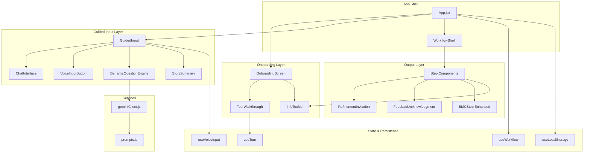

# Design Document: App Functional Enhancements

## Overview

This design extends the Nexus MIA Business Plan Co-Pilot with 13 functional enhancements that transform the application from a linear generation tool into a fully interactive co-creation experience. The enhancements span five domains:

1. **Onboarding & Discovery** — Epistemic scaffolding tooltips, guided tour walkthrough
2. **Input & Voice** — Voice input integration across all inputs, LLM-powered dynamic follow-up questions, contextual story building
3. **Output & Feedback** — Story summary confirmation, visible feedback acknowledgment, proactive refinement invitation, removing visible JSON references
4. **Navigation & Persistence** — Back navigation between steps, progress persistence and resume
5. **Interactive Outputs** — Functional BMC Canvas, information tooltips throughout the app

The architecture leverages the existing React component structure, the `useWorkflow` reducer pattern, the `useLocalStorage` hook, and the Gemini LLM client service. New functionality is introduced via new components, enhanced hooks, and extended prompt templates.

## Architecture



### Key Architectural Decisions

1. **Tooltip System**: A single reusable `InfoTooltip` component wraps an (i) icon trigger with accessible popover behavior. Reused across onboarding, step headers, and inline terms.

2. **Tour as Overlay**: The guided tour runs as an overlay on top of the normal onboarding/workflow UI using a `useTour` hook to manage step state, rather than creating separate tour pages.

3. **Voice Input via Composition**: The existing `useVoiceInput` hook is already well-structured. The `VoiceInputButton` component will be placed adjacent to all text inputs via a wrapper component `VoiceEnabledInput`.

4. **Dynamic Questions via Streaming**: Follow-up questions are generated by calling the Gemini LLM after each user response. A new `useDynamicQuestions` hook manages the LLM call, question queue, and skip behavior.

5. **Story Summary as Phase 4 Enhancement**: The existing Phase 4 (Review & finish) in `GuidedInput` is enhanced with a structured summary that requires explicit confirmation before proceeding.

6. **Feedback Acknowledgment via Diff Description**: After refinement, the system uses a lightweight LLM call to describe what changed, displayed as a banner above the regenerated output.

7. **Back Navigation Already Exists**: The `useWorkflow` reducer already supports `NAVIGATE_BACK`. The enhancement adds a visible "Back" button in the workflow step UI.

8. **No Separate Research Files**: All LLM prompt templates are added to the existing `prompts.js` constants file.

## Components and Interfaces

### New Components

| Component | Location | Purpose |
|-----------|----------|---------|
| `InfoTooltip` | `src/components/shared/InfoTooltip.jsx` | Reusable (i) icon with accessible popover tooltip |
| `TourWalkthrough` | `src/components/TourWalkthrough.jsx` | Overlay tour with step-by-step guided demonstration |
| `TourStep` | `src/components/TourStep.jsx` | Individual tour step card with navigation |
| `VoiceEnabledInput` | `src/components/shared/VoiceEnabledInput.jsx` | Wrapper that pairs any text input with a voice button |
| `StorySummary` | `src/components/GuidedInput/StorySummary.jsx` | Structured summary display with confirm/edit actions |
| `FeedbackAcknowledgment` | `src/components/shared/FeedbackAcknowledgment.jsx` | Banner showing what changed after refinement |
| `RefinementInvitation` | `src/components/shared/RefinementInvitation.jsx` | Pencil icon button placed after each output block |
| `BackButton` | `src/components/shared/BackButton.jsx` | Step-level back navigation button |

### New Hooks

| Hook | Location | Purpose |
|------|----------|---------|
| `useTour` | `src/hooks/useTour.js` | Manages tour state: current step, next/back/exit |
| `useDynamicQuestions` | `src/hooks/useDynamicQuestions.js` | LLM-powered follow-up question generation and queue |

### Enhanced Existing Components

| Component | Enhancement |
|-----------|-------------|
| `OnboardingScreen.jsx` | Add `InfoTooltip` icons to capability items |
| `GuidedInput.jsx` | Integrate `useDynamicQuestions`, add `StorySummary` confirmation gate |
| `ChatInterface.jsx` | Support dynamic questions in message flow, skip button |
| `FeedbackBar.jsx` | Add `FeedbackAcknowledgment` display, remove JSON references from hint text |
| `App.jsx` | Add `BackButton` to workflow step UI, integrate tour |
| `BMCStep.jsx` | Ensure all 9 blocks populated, add inline editing with add/delete |
| All step components | Add `RefinementInvitation` after output blocks |

### Component Interfaces

```typescript
// InfoTooltip
interface InfoTooltipProps {
  content: string;          // Plain-language explanation
  ariaLabel?: string;       // Accessible label for the trigger
  position?: 'top' | 'bottom' | 'left' | 'right';
}

// TourWalkthrough
interface TourWalkthroughProps {
  onComplete: () => void;   // Called when tour finishes or user exits
  onExit: () => void;       // Called when user exits early
}

// VoiceEnabledInput
interface VoiceEnabledInputProps {
  value: string;
  onChange: (value: string) => void;
  placeholder?: string;
  disabled?: boolean;
  multiline?: boolean;
  ariaLabel?: string;
}

// StorySummary
interface StorySummaryProps {
  responses: { basics: string; problem: string; customers: string };
  onConfirm: () => void;
  onEdit: (phaseKey: string) => void;
}

// FeedbackAcknowledgment
interface FeedbackAcknowledgmentProps {
  message: string;          // Plain-language description of changes
  onDismiss: () => void;
}

// RefinementInvitation
interface RefinementInvitationProps {
  onClickRefine: () => void;
  ariaLabel?: string;
}

// BackButton
interface BackButtonProps {
  onBack: () => void;
  disabled?: boolean;
}

// useDynamicQuestions hook return
interface UseDynamicQuestionsReturn {
  generateFollowUp: (userAnswer: string, phase: string, history: Message[]) => Promise<string | null>;
  isGenerating: boolean;
  followUpCount: number;    // Tracks count per base question (max 2)
  resetCount: () => void;
}

// useTour hook return
interface UseTourReturn {
  isActive: boolean;
  currentStep: number;
  totalSteps: number;
  stepData: TourStepData;
  next: () => void;
  back: () => void;
  exit: () => void;
  start: () => void;
}
```

## Data Models

### Tour Step Data

```javascript
const TOUR_STEPS = [
  {
    id: 1,
    title: "Tell Your Story",
    description: "Start by describing your business idea. You can type or use voice input.",
    exampleData: { /* example story text */ },
    targetStep: "story",
  },
  {
    id: 2,
    title: "Driver & Focus",
    description: "The AI analyzes your story through the People-Planet-Prosperity lens.",
    exampleData: { /* example focus output */ },
    targetStep: "focus",
  },
  // ... one entry per workflow step (9 total)
];
```

### Dynamic Question Prompt Context

```javascript
// Added to prompts.js
{
  dynamicFollowUp: (userAnswer, phase, conversationHistory) => `...prompt template...`,
  storySummary: (responses) => `...prompt template for generating structured summary...`,
  feedbackAcknowledgment: (originalOutput, refinedOutput, userFeedback) => `...prompt template...`,
}
```

### Info Tooltip Content Registry

```javascript
// src/constants/tooltips.js
const TOOLTIP_CONTENT = {
  // Onboarding capability tooltips
  "guide-9-steps": "The co-pilot walks you through 9 structured steps...",
  "generate-sdg": "Content is aligned with the UN Sustainable Development Goals...",
  "identify-tensions": "The system finds where your goals might conflict...",
  
  // Step-level tooltips
  "tension-matrix": "A view of where two of your goals push against each other...",
  "dilemma-score": "Each score reflects severity, reversibility, and reach...",
  "bmc": "Business Model Canvas — a one-page template with 9 blocks...",
  "swot": "Strengths, Weaknesses, Opportunities, Threats...",
  
  // Term tooltips (reuses existing GLOSSARY from OnboardingScreen)
  "sdg": "Sustainable Development Goals — 17 global goals adopted by the UN for 2030.",
  "value-proposition": "The unique benefit your product or service provides...",
};
```

### Feedback Acknowledgment State

```javascript
// Added to workflow state (useWorkflow reducer)
{
  feedbackAcknowledgment: {
    stepId: string | null,
    message: string | null,
    visible: boolean,
  }
}
```

### Persisted State Shape (enhanced)

```javascript
// Shape saved to localStorage (extends existing)
{
  phase: "onboarding" | "guided-input" | "workflow",
  currentStep: string,
  completedSteps: string[],
  outputs: Record<string, any>,
  story: string,
  selectedSwotTitle: string,
  guidedInputResponses: { basics: string, problem: string, customers: string },
  tourCompleted: boolean,
}
```


## Correctness Properties

*A property is a characteristic or behavior that should hold true across all valid executions of a system — essentially, a formal statement about what the system should do. Properties serve as the bridge between human-readable specifications and machine-verifiable correctness guarantees.*

### Property 1: Tour Navigation Boundaries

*For any* tour step index between 1 and 9 (inclusive), calling `next()` should produce `min(current + 1, 9)` and calling `back()` should produce `max(current - 1, 1)`. Calling `exit()` from any step should reset to inactive state.

**Validates: Requirements 2.4**

### Property 2: Voice Error Code Mapping

*For any* valid SpeechRecognition error event type (from the set: "not-allowed", "no-speech", "audio-capture", "network", "aborted", and any unknown string), the `useVoiceInput` hook should produce a non-empty, user-friendly error message string that does not expose technical internals.

**Validates: Requirements 3.5**

### Property 3: Story Summary Categorization

*For any* non-empty set of guided input responses (where at least one of basics, problem, or customers has content), the story summary display should organize content into sections corresponding to the three categories (business basics, problem and solution, target customers), and each non-empty response should appear in its corresponding section.

**Validates: Requirements 4.2**

### Property 4: Story Confirmation Gate

*For any* workflow state where the guided input phase is complete but the story summary has not been explicitly confirmed by the user, the system should not transition to the "focus" generation step or trigger any LLM generation call.

**Validates: Requirements 4.5**

### Property 5: Dynamic Question Limit

*For any* sequence of user answers and follow-up question generations within a single base question, the `useDynamicQuestions` hook should never produce more than 2 follow-up questions before signaling that the next base question should be presented.

**Validates: Requirements 5.4**

### Property 6: No JSON References in User-Visible Text

*For any* user-visible text string rendered by the application (including hint text, guidance messages, feedback bar text, and step descriptions), it should not contain the substrings "JSON structure", "JSON format", "JSON schema", or references to internal data format implementation details.

**Validates: Requirements 6.1, 6.2, 6.3**

### Property 7: Back Navigation Correctness

*For any* step in STEP_ORDER that is not the first step ("story"), the workflow should support back navigation, and dispatching a `NAVIGATE_BACK` action with the immediately preceding step should result in `currentStep` being set to that preceding step without modifying `outputs` or `completedSteps`.

**Validates: Requirements 7.1, 7.2**

### Property 8: Navigation Preserves All Outputs

*For any* workflow state containing generated outputs for multiple steps, navigating backward to any completed step and then forward again should preserve all entries in the `outputs` object unchanged — no output data is lost during navigation.

**Validates: Requirements 7.3, 7.4**

### Property 9: Persistence Round-Trip

*For any* valid workflow state (containing currentStep, completedSteps, outputs, story, and selectedSwotTitle), serializing the state to JSON and deserializing it back should produce a deeply equivalent object, and the resume function should restore the workflow to match that state.

**Validates: Requirements 8.1, 8.3**

### Property 10: Refinement Invitation Presence

*For any* workflow step that has non-null generated output in the outputs map (excluding the "story" step), the rendered step UI should contain a `RefinementInvitation` component (pencil icon with "Refine this" label).

**Validates: Requirements 11.1**

### Property 11: BMC Blocks Non-Empty When Data Available

*For any* BMC data object where all 9 block arrays contain at least one item, the BMCStep component should not render any empty-state indicator ("—") for any block.

**Validates: Requirements 12.2**

## Error Handling

### LLM Errors (Dynamic Questions, Feedback Acknowledgment, BMC Generation)

| Error Type | Handling Strategy |
|------------|-------------------|
| Network failure | Display inline error toast, allow retry. Do not block user from continuing with existing content. |
| JSON parse failure | Retry once automatically (existing pattern in `callGeminiJSON`). On second failure, show user-friendly error with retry button. |
| Empty LLM response | Treat as generation failure. Show "Could not generate — try again" message. |
| Rate limiting (429) | Display "Please wait a moment and try again" with exponential backoff suggestion. |
| API key invalid | Redirect to API key screen with explanation. |

### Voice Input Errors

| Error Type | User Message | Recovery |
|------------|--------------|----------|
| `not-allowed` | "Microphone access denied" | Link to browser settings |
| `no-speech` | "Didn't catch that — try again or type your response" | Auto-retry suggestion |
| `audio-capture` | "No microphone detected" | Suggest checking connections |
| `network` | "Network error during speech recognition" | Retry button |
| `aborted` | Silent handling | No action needed |

### LocalStorage Errors

| Error Type | Handling |
|------------|----------|
| `QuotaExceededError` | Log warning to console, continue without persistence. App remains fully functional. |
| Corrupted data (JSON parse failure) | Treat as no saved state. Show onboarding. Log warning. |
| `SecurityError` (private browsing) | Detect on first write, disable persistence silently. |

### Tour Errors

The tour uses static data only — no LLM calls. If tour step data is malformed, skip that step and advance to the next valid step.

### Refinement Errors

If a refinement call fails, preserve the previous output (do not clear it). Show error message with option to retry the refinement or continue with existing output.

## Testing Strategy

### Testing Approach

The testing strategy uses a dual approach:

1. **Property-based tests** for universal properties that should hold across all valid inputs (11 properties identified above)
2. **Example-based unit tests** for specific UI interactions, rendering checks, and integration points

### Property-Based Testing

**Library**: [fast-check](https://github.com/dubzzz/fast-check) (JavaScript property-based testing library, well-integrated with Jest)

**Configuration**:
- Minimum 100 iterations per property test
- Each test tagged with feature and property reference

**Property Tests to Implement**:

| Property | Test File | Key Generators |
|----------|-----------|----------------|
| 1: Tour Navigation | `src/hooks/useTour.test.js` | Integer (1–9) |
| 2: Voice Error Mapping | `src/hooks/useVoiceInput.test.js` | String from set + arbitrary strings |
| 3: Story Summary | `src/utils/compileStory.test.js` | Object with 3 optional non-empty strings |
| 4: Confirmation Gate | `src/hooks/useWorkflow.test.js` | Workflow state objects |
| 5: Dynamic Question Limit | `src/hooks/useDynamicQuestions.test.js` | Sequences of answer/response pairs |
| 6: No JSON References | `src/constants/prompts.test.js` | Scan all static strings |
| 7: Back Navigation | `src/hooks/useWorkflow.test.js` | Step IDs from STEP_ORDER |
| 8: Navigation Preserves Outputs | `src/hooks/useWorkflow.test.js` | Workflow states with random outputs |
| 9: Persistence Round-Trip | `src/hooks/useLocalStorage.test.js` | Arbitrary workflow state objects |
| 10: Refinement Invitation | `src/components/steps/*.test.js` | Step IDs with non-null outputs |
| 11: BMC Non-Empty | `src/components/steps/BMCStep.test.js` | BMC data with all blocks populated |

**Tag Format**: `// Feature: app-functional-enhancements, Property {N}: {title}`

### Example-Based Unit Tests

| Area | Tests |
|------|-------|
| InfoTooltip | Renders (i) icon, shows on hover/click, dismisses on Escape/outside click, accessible aria |
| TourWalkthrough | Renders 9 steps, shows progress, navigation works, exit returns to onboarding |
| VoiceInputButton | Hidden when unsupported, toggles recording state, streams transcript |
| StorySummary | Renders all sections, confirm triggers callback, edit navigates back |
| FeedbackAcknowledgment | Renders message, dismissible, positioned above output |
| RefinementInvitation | Renders pencil icon, click opens refinement input |
| BackButton | Visible on non-first steps, hidden on story step |
| BMCStep | All 9 blocks render, inline edit works, add/delete items |

### Integration Tests

| Area | Tests |
|------|-------|
| Dynamic Questions | Mock Gemini, verify prompt construction, response handling |
| Feedback Acknowledgment | Mock Gemini, verify diff description generation |
| Voice + Input | Mock SpeechRecognition, verify full flow from start to transcript |
| Persistence | Verify localStorage read/write with debouncing |

### Test Dependencies

```json
{
  "devDependencies": {
    "fast-check": "^3.x",
    "@testing-library/jest-dom": "^6.x",
    "@testing-library/react": "^16.x"
  }
}
```
