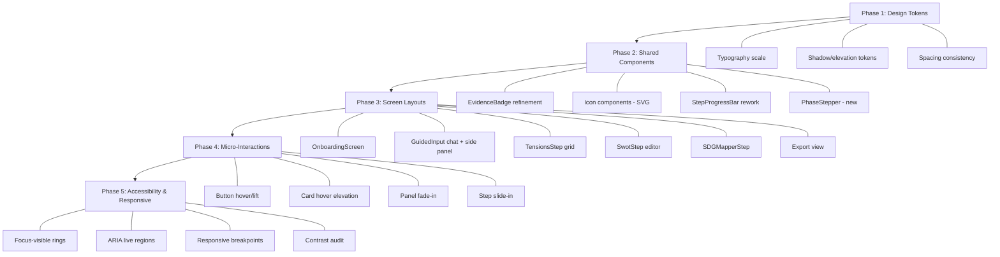

# Design Document: UI/UX Figma Rework

## Overview

This design covers the visual and interaction polish pass for the Nexus MIA Business Model Co-Pilot application. The rework aligns the existing functional codebase with high-fidelity Figma designs across six key screens and shared design system tokens. No business logic changes — this is purely presentation layer refinement.

The approach is incremental: update CSS custom properties (design tokens) first, then refine shared components, then update screen-specific layouts. All changes use the existing technology (inline styles + global CSS in `index.css`, React 18 functional components) — no new dependencies are introduced.

### Design Decisions

1. **No new CSS framework** — continue with CSS custom properties + inline styles to keep bundle size unchanged and avoid migration risk.
2. **SVG icons inline** — replace emoji placeholders with inline SVG components (no icon library dependency). Each icon is a lightweight React component returning an `<svg>` element.
3. **Animation via CSS keyframes** — all micro-interactions use CSS `@keyframes` and `transition` properties defined in `index.css`, respecting `prefers-reduced-motion`.
4. **Token-first updates** — update `:root` custom properties first so downstream components inherit changes automatically.
5. **Component composition** — new visual elements (Phase Stepper, Format Card, etc.) are small, focused components that compose with existing ones.

---

## Architecture

The rework does not alter application architecture. The existing layered structure remains:

```
┌─────────────────────────────────────────────────┐
│  App.jsx (routing, state orchestration)         │
├─────────────────────────────────────────────────┤
│  Screen Components                              │
│  ┌───────────┐ ┌───────────┐ ┌───────────┐     │
│  │Onboarding │ │GuidedInput│ │ Workflow   │     │
│  │Screen     │ │ (phases)  │ │ Steps      │     │
│  └───────────┘ └───────────┘ └───────────┘     │
├─────────────────────────────────────────────────┤
│  Shared Components (Badge, Card, Icon, etc.)    │
├─────────────────────────────────────────────────┤
│  Design System (index.css tokens + animations)  │
└─────────────────────────────────────────────────┘
```

### Change Strategy



---

## Components and Interfaces

### New Components

#### 1. `src/components/shared/Icon.jsx`

A collection of inline SVG icon components replacing emoji placeholders.

```jsx
// Exports: ShieldIcon, RobotIcon, MicrophoneIcon, SendIcon, CheckmarkIcon, ExternalLinkIcon
export function ShieldIcon({ size = 32, color = "var(--color-brand)" }) { ... }
export function RobotIcon({ size = 24 }) { ... }
```

**Props:** `size` (number, px), `color` (CSS color string), `className` (optional)

#### 2. `src/components/shared/PhaseStepper.jsx`

Horizontal stepper for the Guided Input flow (Requirement 3).

```jsx
export default function PhaseStepper({ phases, currentPhase, completedPhases }) { ... }
```

**Props:**
- `phases` — Array of `{ id: number, label: string }`
- `currentPhase` — number (1-based)
- `completedPhases` — Array of completed phase IDs

**Renders:** 28px numbered circles connected by 2px lines, with phase labels below.

#### 3. `src/components/shared/FormatCard.jsx`

Export format card for the Export screen (Requirement 12).

```jsx
export default function FormatCard({ format, icon, iconColor, description, onExport }) { ... }
```

**Props:**
- `format` — string ("Word", "PowerPoint", "Notion")
- `icon` — string (single letter: "W", "P", "N")
- `iconColor` — CSS color for the icon background
- `description` — string
- `onExport` — callback

#### 4. `src/components/shared/SidePanel.jsx` (refactored)

Already exists in GuidedInput. Refactored into a reusable shell for:
- GuidedInput "Why we're asking" panel
- Tensions detail panel
- SWOT edit timeline panel

```jsx
export default function SidePanel({ title, children, sticky = true }) { ... }
```

### Modified Components

| Component | Changes |
|-----------|---------|
| `OnboardingScreen.jsx` | Replace emoji icons with SVG ShieldIcon; update typography to 2rem/700 heading; add glossary table bands; relocate CTAs to bottom-right; add 9-step progress circles |
| `StepProgressBar.jsx` | Update circle to 36px diameter; add "Step X of 9" label below current; refine connector lines to 2px green for completed |
| `StepNav.jsx` | Merge visual logic with StepProgressBar (single component); remove duplication |
| `GuidedInput.jsx` | Replace dot indicators with PhaseStepper; add SidePanel with "Why we're asking" content; refine bottom navigation layout |
| `ChatInterface.jsx` | Add robot icon to AI bubbles; update bubble border-radius asymmetry; refine ReflectionCard green quotes |
| `TensionsStep.jsx` | Add step bar at top; update column headers to uppercase 11px/700; refine filter toggles to pill shape; update Evidence_Badge pill sizing |
| `SwotStep.jsx` | Refine sub-nav circle sizes (26px); add hover pencil reveal on items; add Before/After edit display |
| `SDGMapperStep.jsx` | Update grid to auto-fill minmax(200px, 1fr); add 5px colored top border per card; add status icons (✓/~/?) in top-right; add anti-greenwashing side panel |
| `ExportModal.jsx` / Export view | Convert to full-screen export view with FormatCards; add audit trail section; add privacy reminder banner |
| `EvidenceBadge.jsx` | Update to pill shape (12px radius); standardize padding to 5px/10px; enforce 11px/600 typography |
| `index.css` | Add shadow Level 3 token; add typography caption scale; add slide-in keyframe; add button lift micro-interaction; refine focus-visible rules |

### Interface Contracts (Props)

No prop interface changes to parent components — all modifications are internal rendering. The `App.jsx` orchestration layer remains untouched.

---

## Data Models

No data model changes. This rework is purely presentational. The existing data shapes consumed by components remain:

```typescript
// Existing - unchanged
interface TensionData {
  tensions: Array<{
    id?: string;
    title?: string;
    tension?: string;
    description?: string;
    why?: string;
    columns?: string[];
    rows?: string[];
    evidenceLevel?: string;
    evidence_level?: string;
    inference_level?: string;
    resolved?: boolean;
    driver_a?: string;
    driver_b?: string;
    sources?: string[];
  }>;
}

interface SwotData {
  swot?: Array<{
    title: string;
    S: string[];
    W: string[];
    O: string[];
    T: string[];
  }>;
  // or SwotOutput shape:
  strengths?: Array<{ id: string; text: string }>;
  weaknesses?: Array<{ id: string; text: string }>;
  opportunities?: Array<{ id: string; text: string }>;
  threats?: Array<{ id: string; text: string }>;
}

// New CSS tokens (added to :root)
// --shadow-lg: 0 8px 24px rgba(0,0,0,0.12)
// --font-caption: 0.6875rem
// --font-label: 0.75rem
```

### Design Token Additions to `:root`

```css
:root {
  /* New additions */
  --shadow-lg: 0 8px 24px rgba(0,0,0,0.12);
  --font-caption: 0.6875rem;
  --font-label: 0.75rem;
  --transition-lift: transform 0.15s ease, box-shadow 0.2s ease;
}
```

---

## Error Handling

No new error states are introduced. Existing error handling (ErrorBanner, error state in workflow reducer) continues unchanged. Visual refinements include:

1. **Error banner styling** — ensure consistent use of `var(--color-danger)` and `var(--color-danger-light)` per Requirement 16.4.
2. **Disabled state clarity** — buttons at opacity 0.5 with `cursor: not-allowed` (Requirement 6.3).
3. **Empty state messaging** — detail panels show italic placeholder text when no selection exists (already implemented, styling refined).

---

## Testing Strategy

### Why Property-Based Testing Does NOT Apply

This feature is a **UI rendering and visual polish** pass. It involves:
- CSS token value changes
- Component border-radius, padding, and shadow adjustments
- Animation keyframes and transitions
- Icon replacement (emoji → SVG)
- Layout rearrangement (grid templates, flexbox)

None of these produce pure functions with meaningful input variation suitable for property-based testing. There is no data transformation logic, no serialization, no parsing, and no business rule processing. The correct testing approach is **example-based rendering tests** and **visual regression**.

### Testing Approach

#### 1. Snapshot Tests (Primary)

Each modified component gets a snapshot test verifying rendered output matches expected structure.

```
src/components/__tests__/
  OnboardingScreen.test.jsx
  StepProgressBar.test.jsx
  PhaseStepper.test.jsx
  EvidenceBadge.test.jsx
  FormatCard.test.jsx
  Icon.test.jsx
```

**Tool:** `@testing-library/react` + Jest (already in devDependencies)

#### 2. Accessibility Tests

- **Focus management:** Verify `:focus-visible` class application via `@testing-library/react` `toHaveFocus()`.
- **ARIA live regions:** Assert `aria-live="polite"` content updates on step change.
- **Contrast:** Manual audit with browser DevTools (not automatable in unit tests).
- **Role/label assertions:** Test that `role`, `aria-label`, `aria-current` attributes render correctly.

#### 3. Responsive Behavior Tests

- Use `matchMedia` mocks to verify compact progress bar renders at <768px.
- Verify grid column changes at breakpoints via computed style assertions.

#### 4. Interaction Tests

- Hover states: `fireEvent.mouseEnter` → verify style/class changes.
- Keyboard navigation: `fireEvent.keyDown` with Arrow/Enter/Escape → verify focus movement and selection.
- Reduced motion: Mock `window.matchMedia('(prefers-reduced-motion: reduce)')` → verify animations disabled.

### Test Coverage Targets

| Area | Method | Count |
|------|--------|-------|
| Design tokens applied | Snapshot | 6 tests |
| Component rendering | Snapshot + assertion | 10 tests |
| Accessibility attributes | Assertion | 8 tests |
| Keyboard interactions | Event simulation | 5 tests |
| Responsive breakpoints | Media query mock | 4 tests |
| Micro-interactions | Class/style assertion | 4 tests |

### Running Tests

```bash
npx react-scripts test --watchAll=false
```

All tests use the existing `react-scripts test` runner with `@testing-library/react`. No additional test dependencies required.
